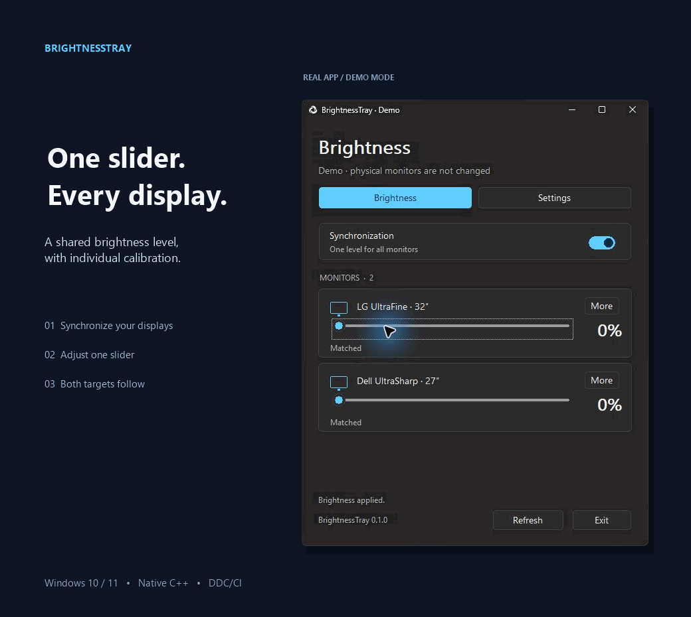
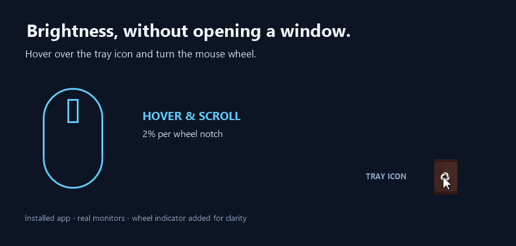
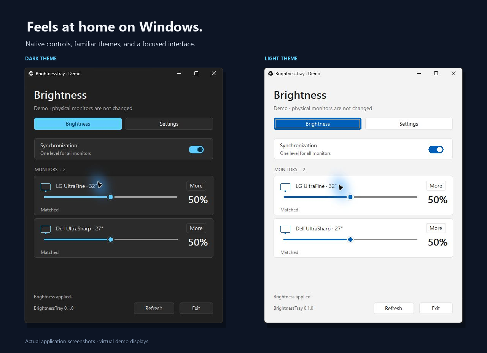
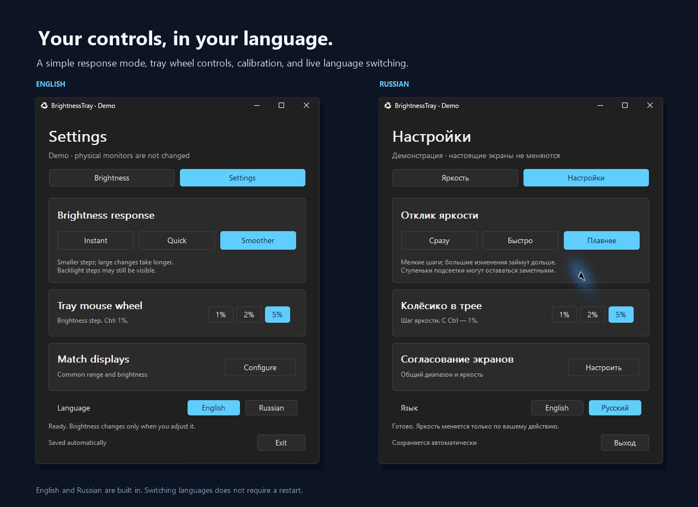
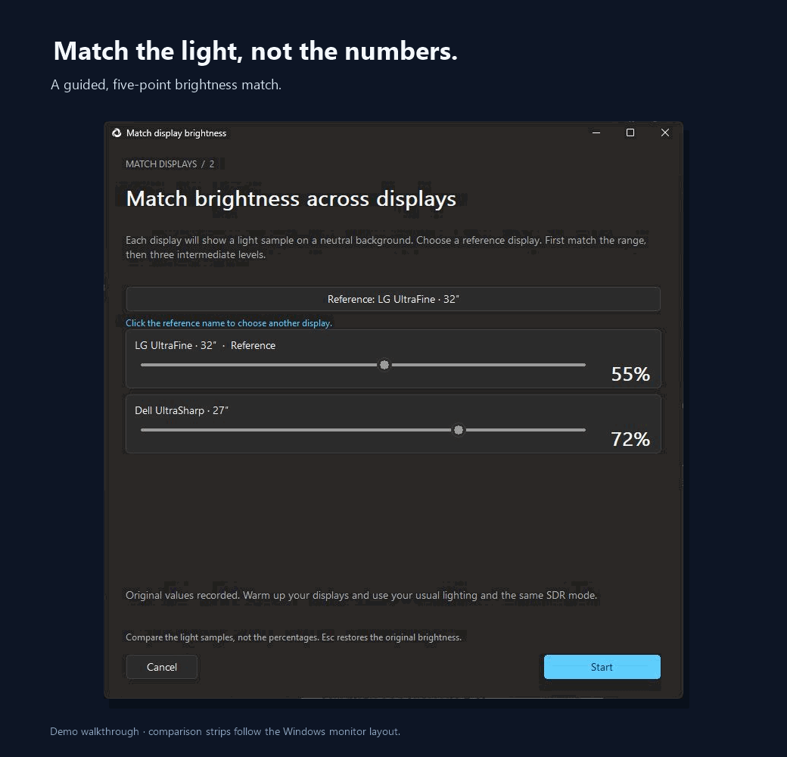
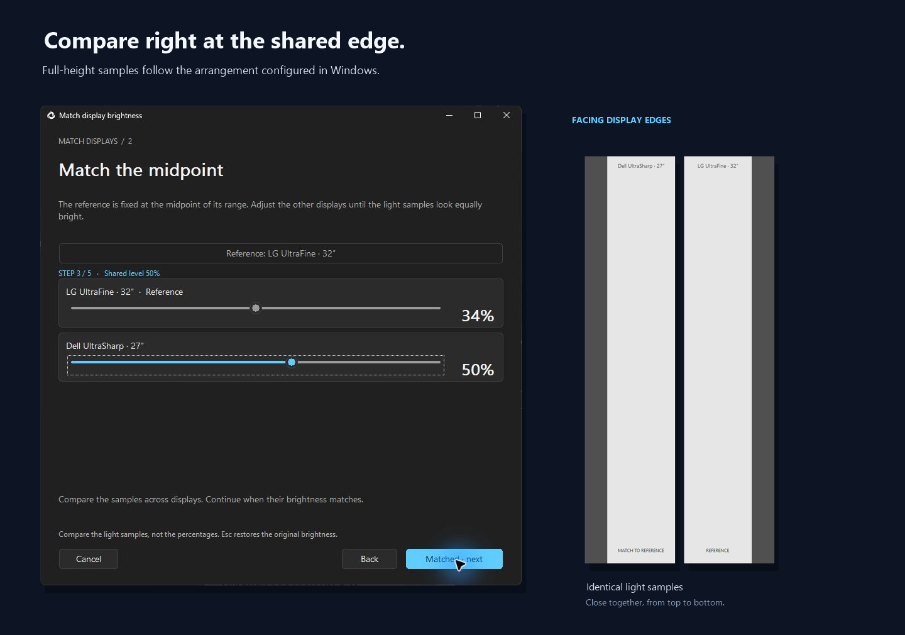

# BrightnessTray

A lightweight Windows tray application for external monitor brightness, built with C++17, Win32, and DDC/CI. No Electron, WebView, .NET, telemetry, or network access in the application.

**[Download for Windows](https://github.com/998ab/WindowsBrightnessTray/releases/latest)** · [See calibration](#match-displays) · [Build from source](#build-and-test)

Version 0.2.0 introduces a compact tray popup with one shared slider for linked monitors, separate target and confirmed brightness, and procedural sun animation. Settings scroll on short work areas, and keyboard navigation keeps focused controls visible. The recordings below show the earlier 0.1.0 interface.

  <picture>
    <source media="(prefers-reduced-motion: reduce)" srcset="docs/media/synchronization-still.png">
    
  </picture>

*Actual application UI, captured in demo mode. The animation illustrates shared slider targets, not physical panel response.*

## Download and install

Download from [Releases](https://github.com/998ab/WindowsBrightnessTray/releases/latest).

- **Setup x64:** per-user installation, Start menu shortcut, and uninstaller. No administrator rights required. Desktop shortcuts and starting with Windows are optional.
- **Portable x64 ZIP:** extract and run BrightnessTray.exe.
- **SHA256SUMS.txt:** SHA-256 checksums for both downloads.

Requires Windows 10 version 1809 or later, or Windows 11, on x64. Enable DDC/CI in your monitor menu. No separate Visual C++ Redistributable is required. The initial release is unsigned.

Use **Exit** before installing or upgrading. Preferences and calibration are preserved. Uninstalling keeps the user profile for future reuse.

## Controls

  <picture>
    <source media="(prefers-reduced-motion: reduce)" srcset="docs/media/tray-scroll-still.png">
    
  </picture>

*Recorded on the installed 0.1.0 application with real monitors and the main window closed. The mouse-wheel indicator is an added annotation; the tray icon and percentage popup are real captures. Version 0.2.0 removes the separate wheel popup. Screen recording shows the brightness target, not physical backlight luminance.*

- Hover over the tray icon and scroll to adjust brightness without opening a window. Choose a 1%, 2%, or 5% wheel step; hold Ctrl for 1%. High-resolution deltas accumulate.
- Left-click to show or hide the window. Closing it or pressing Escape hides it in the tray. **Exit** stops the application.
- Right-click for presets, synchronization, settings, and monitor selection.
- Synchronize supported monitors using their calibration curves, or adjust displays separately.
- Linked displays use one shared slider. The thumb sets the target; the blue line follows acknowledged brightness, interpolated at the measured device response cadence. The line can lag the acknowledgement slightly; numeric monitor levels remain direct confirmations.
- The procedurally drawn sun responds immediately to brightness input, turns clockwise for increasing brightness and counterclockwise for decreasing brightness, and fades out smoothly after the last input without snapping to a fixed pose. Only the current tray icon is retained; animation timers stop when idle.
- The interface follows the Windows light/dark theme and per-monitor DPI.

## Interface

## Languages and response

English and Russian are embedded in the executable. The first launch follows the Windows display language. **Settings → Language** changes it immediately and saves the choice.

One setting controls brightness response:

- **Instant:** apply the final hardware value directly.
- **Quick:** a moderate transition, with a 600 ms timing target and maximum 5% hardware step.
- **Smoother:** hardware steps limited to 1% of the native range. Large changes take longer.

Actual response depends on the monitor, driver, integer scale, and DDC/CI latency. Software interpolation cannot eliminate visible hardware steps. Parallel calls may be serialized by the driver; simultaneous physical changes are not guaranteed. GPU gamma, color profiles, HDR, and monitor color settings are not changed.

## Match displays

  <picture>
    <source media="(prefers-reduced-motion: reduce)" srcset="docs/media/calibration.png">
    
  </picture>

Open **Settings → Match displays → Configure**, or a display's **More → Match displays · use as reference** menu item.

The wizard matches a shared minimum, maximum, and 25/50/75% points. Light strips appear at facing edges using the monitor arrangement in Windows. Side-by-side displays use the complete height; stacked displays use the complete width. Controls stay away from the reference strip.

View the full-height comparison samples at the shared display edge

Calibration changes apply directly without animation. **Cancel** restores exact original hardware values. Profiles are saved only after completing the wizard. Existing three-point profiles remain readable.

This is approximate visual matching, not colorimeter calibration or a measurement in cd/m². See [the design and limitations](docs/calibration.md).

## Settings and privacy

The profile is stored in %LOCALAPPDATA%/BrightnessTray/settings.ini: language, response, wheel step, synchronization, and monitor curves. Portable and installed versions share this profile. Demo mode uses settings-demo.ini.

The application does not contact servers or check for updates. Updates are available from GitHub Releases.

## Build and test

Install Visual Studio 2022 C++ Build Tools with the Windows SDK, then run:

~~~powershell
./build.ps1 -OutputDirectory build/release
./build/release/BrightnessTray.exe
~~~

The script uses a static C++ runtime and runs calibration, layout, localization, worker, tray, display-name, native popup, failure-cleanup, and UI focus/scroll tests. Tests do not change physical brightness. CMake with MSVC also supports Release builds and CTest.

Run scripts/package-icon.ps1 to regenerate the ICO from the original PNG.

## Package a release

Install [Inno Setup 6 or 7](https://jrsoftware.org/isdl.php), then run:

~~~powershell
./scripts/package.ps1 -BuildDirectory build/release -InnoCompiler 'C:/Program Files/Inno Setup 7/ISCC.exe'
./scripts/test-installer.ps1
~~~

Exit the normal application before the installer test. It installs into build/installer-smoke, verifies files, uninstalls them, and checks that the existing profile was preserved. Artifacts and checksums go to build/dist.

The version is defined in src/version.h. GitHub Actions tests pushes and pull requests. A version tag, a manual publish run, or a main-branch commit containing **[release]** publishes after build, package, and installer checks pass. See [the workflow](.github/workflows/build.yml).

## Development options

- **--demo:** two virtual displays without physical brightness changes. Naming the EXE BrightnessTray.Demo.exe also enables this mode.
- **--lang=en / --lang=ru:** language override for one launch.
- **--light / --dark:** application theme override for one launch.
- **--trace:** opt-in local diagnostics in brightness-trace.csv beside the EXE. Records requested/sent values and call durations, not screen content or monitor names. Limited to 20,000 rows; disabled by default.

English text is maintained in source and locales/en.tsv. Russian translations live in locales/ru.tsv; installer translations live in locales/installer-ru.iss. Catalogs are embedded and validated on each build. Documentation, comments, release notes, and build output are in English.

## License

Free to use, including within businesses. You may modify and distribute copies or modified versions **free of charge**, retaining the license and attribution. Selling the software or modified versions is prohibited without separate permission.

See [LICENSE](LICENSE). This is source-available software with a no-sale restriction, **not an OSI-approved open-source license**.
