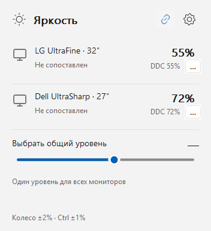

# BrightnessTray

Control external monitor brightness from the Windows tray. Native C++/Win32 app using DDC/CI.

[Download](https://github.com/998ab/WindowsBrightnessTray/releases/latest) · [Release notes](docs/releases/v0.2.0.md) · [Build and packaging](docs/development.md)



## Install

Windows 10 1809+ or Windows 11, x64. Enable **DDC/CI** in your monitor's menu.

- **Setup:** per-user installer; no administrator rights required.
- **Portable ZIP:** extract and run `BrightnessTray.exe`.

Exit the app before upgrading. Settings and calibration are preserved. Binaries are unsigned.

## Use

- **Click the tray sun** to open or hide the panel. **Esc** closes the panel.
- **Scroll over the sun** to change brightness. **Ctrl + wheel** uses 1% steps.
- **Link monitors** for one shared slider, or adjust them separately.
- The **thumb** sets the target; the **blue line** follows confirmed brightness.
- **Settings** has language, wheel step, brightness response and display matching.
- **Right-click the sun** for presets and **Exit**.

English and Russian; Windows light/dark theme. No telemetry, network access or automatic update checks.

## Match displays

Open **Settings → Match displays → Configure**. The wizard matches minimum, maximum and 25/50/75% brightness across displays. **Cancel** restores the original levels.

Matching is visual, not a colorimeter measurement. Hardware steps and slow monitor responses can remain visible. [Calibration details](docs/calibration.md).

## Build

Install Visual Studio 2022 C++ Build Tools with the Windows SDK:

```powershell
./build.ps1 -OutputDirectory build/release
./build/release/BrightnessTray.exe
```

The script builds the app and runs tests without changing physical brightness. [Packaging, diagnostics and development options](docs/development.md).

## Settings

Stored in `%LOCALAPPDATA%\BrightnessTray\settings.ini`. Portable and installed versions share this profile.

## License

Free to use and redistribute free of charge. Selling copies or modified versions requires separate permission. [License](LICENSE).
