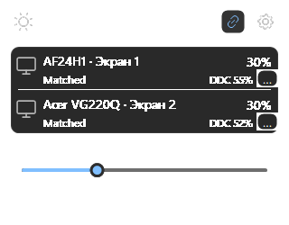
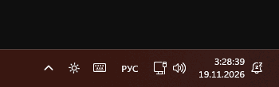

# BrightnessTray

A small Windows tray application for adjusting external monitor brightness through DDC/CI.

[Download](https://github.com/998ab/WindowsBrightnessTray/releases/latest) · [Release notes](docs/releases/v0.2.5.md) · [Contributing](CONTRIBUTING.md)

[](https://github.com/998ab/WindowsBrightnessTray/releases/latest)
[](https://github.com/998ab/WindowsBrightnessTray/actions/workflows/build.yml)
[](https://github.com/998ab/WindowsBrightnessTray/releases)
[](https://github.com/998ab/WindowsBrightnessTray/stargazers)
[](https://github.com/998ab/WindowsBrightnessTray/forks)
[](LICENSE)

Click the sun icon in the notification area, beside the Windows clock. The panel opens next to that icon. If the icon is hidden, expand the **⌃** menu first.



<sub>Captured from the installed v0.2.5 application at 100% display scale. Original pixels; no presentation background.</sub>

## Install

1. Enable **DDC/CI** in your monitor's on-screen menu.
2. [Download the latest release](https://github.com/998ab/WindowsBrightnessTray/releases/latest). Choose **Setup** for installation, or extract the **Portable ZIP**.
3. Run BrightnessTray and find the sun icon in the notification area.

**Requirements:** Windows 10 1809+ or Windows 11, x64, and an external monitor with working DDC/CI support. Support and response time depend on the monitor, driver, and connection adapters.

The installer runs per user without administrator rights and offers an optional **start with Windows** task. Exit BrightnessTray before upgrading; preferences and calibration are preserved. Release files include SHA-256 checksums. Binaries are unsigned.

## Adjust brightness

Scroll while the pointer is **over the tray icon**. The panel can stay closed. Scrolling up increases brightness; scrolling down decreases it.

<picture>
  <source media="(prefers-reduced-motion: reduce)" srcset="docs/media/tray-live-still.png">
  
</picture>

<sub>Recorded from the Windows notification area. The icon, pointer, hover state, and tooltip are captured directly. [Media notes](docs/media/README.md).</sub>

| Action | Result |
| --- | --- |
| Wheel over the tray icon or a slider | Adjust brightness by the selected 1%, 2%, or 5% step. |
| **Ctrl + wheel** | Adjust in 1% steps. |
| Click the tray icon | Open or hide the panel. |
| Click the link button | Switch between shared and individual monitor control. |
| Right-click the tray icon | Open presets, monitor selection, and Exit. |
| **Esc** | Dismiss the panel or cancel calibration. |

The slider thumb sets the target. The blue line follows brightness acknowledged by the monitor; it does not measure physical luminance. Brightness is restored after sleep or display power-off, with retries while monitors wake.

## Calibration

Different monitors can look different at the same percentage. Open **Settings → Match displays → Configure** to match a common minimum, maximum, and three intermediate points.

At 25%, 50%, and 75%, the reference display stays fixed while you adjust the others. Comparison strips appear at facing screen edges. **Cancel restores the original brightness.** Matching is visual, rather than a colorimeter measurement. [Calibration guide](docs/calibration.md).

To use the full hardware range again, turn **Settings → Calibration** off. Turn it back on to reuse the saved curves. Switching modes preserves the current hardware brightness.

## Settings

Choose the response speed, wheel step, calibration state, and language. Light and dark themes follow Windows. English and Russian are included.

The linked two-monitor panel is 320 × 250 DIPs; Settings is 320 × 348 DIPs. Small work areas use scrolling. Both installed and portable versions use the same profile:

```text
%LOCALAPPDATA%\BrightnessTray\settings.ini
```

<details>
<summary>Troubleshooting</summary>

**A monitor is missing or does not respond.** Check DDC/CI in the monitor's menu, then use **Settings → Refresh**. Some adapters and connection paths do not pass DDC/CI commands.

**Brightness changes in visible steps.** Monitor firmware can limit brightness resolution and command speed. Try a different response preset in Settings.

**The icon is missing.** Expand the Windows notification area's **⌃** menu. You can drag the sun icon from that menu onto the taskbar.

</details>

## Build from source

Install Visual Studio 2022 C++ Build Tools and the Windows SDK, then run:

```powershell
./build.ps1 -OutputDirectory build/release
./build/release/BrightnessTray.exe
```

The build runs the test suite using virtual monitors. [Development and packaging](docs/development.md).

## Contributing

Bug reports, translations, documentation improvements, and pull requests are welcome. See [CONTRIBUTING.md](CONTRIBUTING.md) or [open an issue](https://github.com/998ab/WindowsBrightnessTray/issues/new).

Written in C++/Win32. No account, telemetry, network access, or automatic update checks. [MIT licensed](LICENSE).

<sub>Download counters count release files, not unique users. [Media provenance and static alternatives](docs/media/README.md).</sub>
