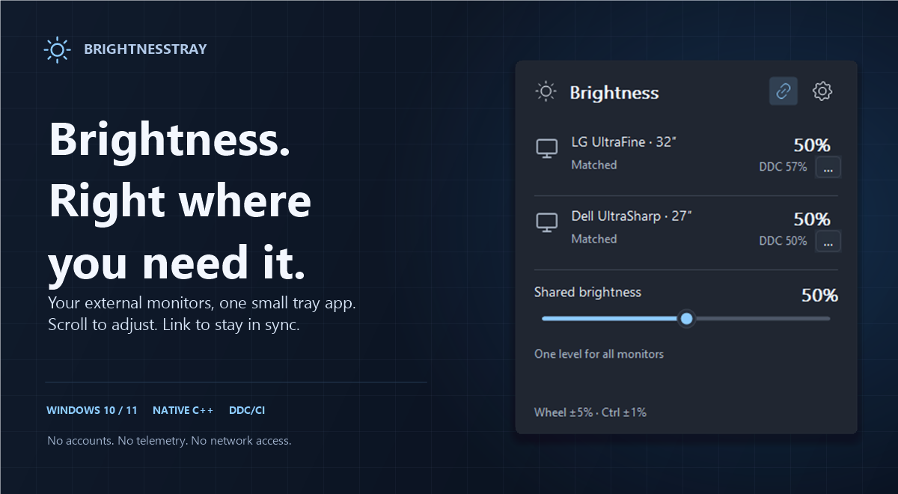
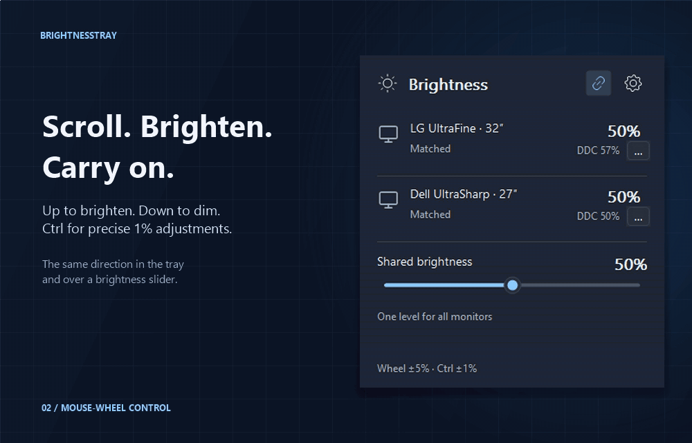
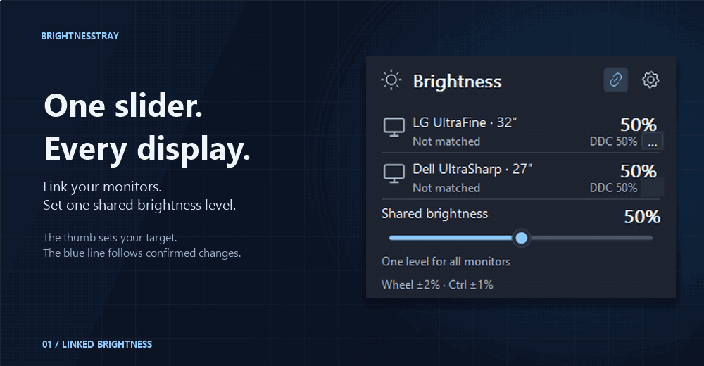
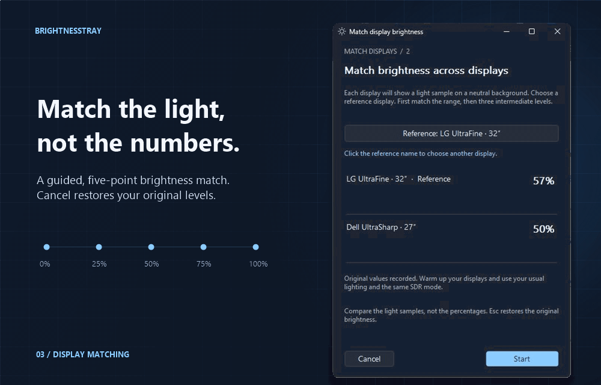
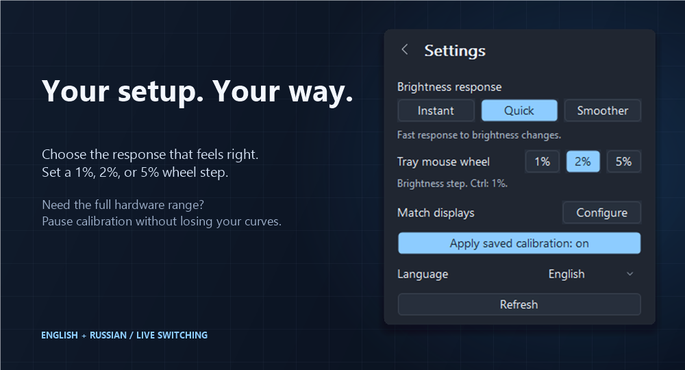
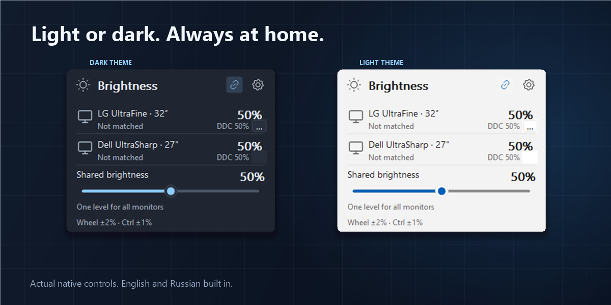

<div align="center">

# BrightnessTray

**External monitor brightness. Right in your Windows tray.**

[**Download for Windows**](https://github.com/998ab/WindowsBrightnessTray/releases/latest) &nbsp; · &nbsp; [What's new](docs/releases/v0.2.2.md) &nbsp; · &nbsp; [Build from source](docs/development.md)

Windows 10 / 11 · x64 · DDC/CI · English & Russian

</div>



BrightnessTray puts your external displays within a scroll of your mouse. Adjust one monitor or link them together, match their brightness, and get back to what you were doing.

| Scroll to adjust | Link your displays | Keep it local |
| --- | --- | --- |
| Wheel up to brighten, down to dim. Hold **Ctrl** for 1% steps. | One shared slider, with a separate calibration curve for each display. | Native C++/Win32. No account, telemetry, network access, or update checks. |

## Up to brighten. Down to dim.

Scroll over the tray sun to adjust brightness without opening the panel. The same direction works over a slider. Choose a **1%, 2%, or 5%** wheel step in Settings; **Ctrl + wheel** always uses 1%.

<picture>
  <source media="(prefers-reduced-motion: reduce)" srcset="docs/media/wheel-still.png">
  
</picture>

## One slider. Every display.

Click the **link** button to control your monitors together, or unlink them for individual adjustment. The thumb sets your target; the blue line follows brightness acknowledged by the monitor.

<picture>
  <source media="(prefers-reduced-motion: reduce)" srcset="docs/media/brightness-still.png">
  
</picture>

Click the sun to open or hide the panel. Press **Esc** to dismiss it. Right-click the tray icon for presets, monitor selection, and **Exit**. Brightness is also restored after system sleep or display power-off, with retries while monitors wake.

## Match the light, not the numbers.

Different monitors can look very different at the same percentage. **Settings → Match displays → Configure** walks you through a shared minimum, maximum, and three intermediate points.

<picture>
  <source media="(prefers-reduced-motion: reduce)" srcset="docs/media/calibration-still.png">
  
</picture>

At the 25%, 50%, and 75% stages, the reference stays fixed while you match the other displays. Comparison strips sit at facing display edges. **Cancel restores the original brightness.** Matching is visual, rather than a colorimeter measurement. [How calibration works →](docs/calibration.md)

### Your full brightness range is still there.

Turn **Settings → Apply saved calibration** off to use each monitor's full hardware range, including its maximum brightness. Turn it back on to use the matched range again. Your curves are preserved, and switching modes keeps the current hardware brightness.



## At home on Windows.

Light and dark themes follow Windows. English and Russian are built in, with live language switching. The panel stays compact, and settings and calibration are shared between the installed and portable versions.



## Get started

1. Enable **DDC/CI** in your monitor's on-screen menu.
2. [Download the latest release](https://github.com/998ab/WindowsBrightnessTray/releases/latest): choose the **Setup** installer or the **Portable ZIP**.
3. Run BrightnessTray and look for the sun in the Windows tray. Scroll to adjust brightness.

The installer is per-user and needs no administrator rights. It offers an optional **start with Windows** task. The portable version only needs to be extracted and run.

**Requirements:** Windows 10 1809+ or Windows 11, x64, and an external monitor with working DDC/CI support. Monitor firmware and connection adapters can affect availability and response time.

**Upgrading:** exit BrightnessTray first. Preferences and calibration are preserved. Release downloads include SHA-256 checksums; binaries are unsigned.

<details>
<summary><strong>Useful details</strong></summary>

### A monitor is missing or does not respond

Check that DDC/CI is enabled in the monitor menu, then use **Settings → Refresh**. Support depends on the monitor, driver, and connection path.

### What does the blue line actually mean?

It follows values acknowledged by the monitor. It does not measure physical luminance. Hardware brightness steps and irregular response times can still be visible.

### Where are my settings?

`%LOCALAPPDATA%\BrightnessTray\settings.ini`

The installed and portable versions use the same profile. Demo mode uses virtual monitors and a separate profile.

### Build from source

Install Visual Studio 2022 C++ Build Tools with the Windows SDK, then run:

```powershell
./build.ps1 -OutputDirectory build/release
./build/release/BrightnessTray.exe
```

The build also runs the test suite without changing physical monitor brightness. [Development and packaging →](docs/development.md)

</details>

<sub>Images and GIFs show the actual v0.2.2 native interface with virtual demo monitors. Presentation backgrounds and captions are added; UI controls are not redrawn. [Media notes and still images](docs/media/README.md).</sub>

---

Free to use and redistribute free of charge. Selling copies or modified versions requires separate permission. [License](LICENSE).
